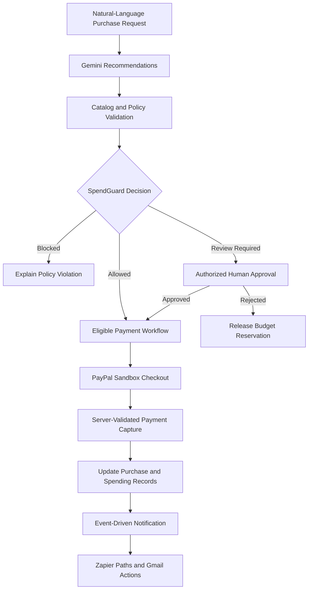
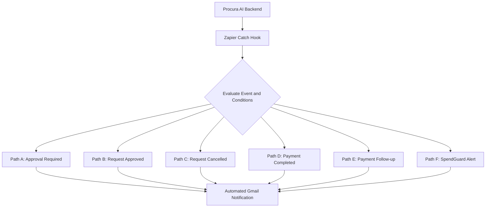

# Procura AI

### Smarter purchasing. Controlled spending. Secure payment workflows.

Procura AI is an AI-powered procurement platform that helps small businesses make smarter purchasing decisions without losing control of their budgets. It combines natural-language product recommendations, backend-enforced spending policies, human approvals, PayPal Sandbox checkout, and event-driven workflow notifications in one platform.

<p align="center">
  
</p>

<p align="center">
  <a href="https://procura-io.onrender.com">Live Demo</a> ·
  <a href="https://github.com/dineshit27/procura-ai">Source Code</a> ·
  <a href="https://procura-ai-f4eo.onrender.com/api/health">API Health</a>
</p>

<p align="center">
  
  
  
  
  
  
  
  
</p>

**Built for the PayPal AI Hackathon.**

> **Demo notice:** Supplier catalogs and purchasing records may contain simulated demonstration data. Payments use PayPal Sandbox and do not move real money. Availability of individual features depends on the deployed demo environment.

---

## Table of Contents

- [The Problem](#the-problem)
- [The Solution](#the-solution)
- [What Makes Procura AI Different](#what-makes-procura-ai-different)
- [Judge Demo Instructions](#judge-demo-instructions)
- [Recommended Demo Flow](#recommended-demo-flow)
- [How It Works](#how-it-works)
- [SpendGuard Policy Engine](#spendguard-policy-engine)
- [Workflow Automation with Zapier](#workflow-automation-with-zapier)
- [Authentication and Role-Based Access](#authentication-and-role-based-access)
- [Technology Stack](#technology-stack)
- [Architecture](#architecture)
- [Getting Started](#getting-started)
- [Environment Configuration](#environment-configuration)
- [Zapier Setup](#zapier-setup-and-automation)
- [Testing and Build](#testing-and-build)
- [Deployment](#deployment)
- [Security and Limitations](#security-and-limitations)
- [Future Scope](#future-scope)
- [License](#license)

---

## The Problem

Small businesses often manage procurement through spreadsheets, disconnected supplier catalogs, manual approvals, and separate payment workflows.

These disconnected processes make it difficult to:

- Find suitable products for business requirements.
- Enforce purchasing limits consistently.
- Monitor cumulative spending and available budgets.
- Route purchases to the appropriate approver.
- Track payment status and purchasing history.
- Maintain visibility into why a purchase was allowed, blocked, or sent for review.

Procura AI brings these activities into a unified procurement workflow.

## The Solution

Procura AI connects AI-assisted purchasing with deterministic financial controls and payment processing.

### Core Features

- **AI Procurement Recommendations:** Convert natural-language purchasing requirements into catalog-grounded recommendations using Google Gemini, with deterministic fallback behavior where configured.
- **SpendGuard Policy Engine:** Evaluate purchasing requests against backend-enforced order limits, quantity restrictions, supplier rules, budget limits, and approval requirements.
- **Human-in-the-Loop Approvals:** Route purchases requiring review through authorized approval workflows.
- **PayPal Sandbox Checkout:** Create payment orders and capture eligible payments through a server-side payment flow.
- **Budget Visibility:** Track paid spending, reserved amounts, available budget, and purchasing history.
- **Role-Based Access Control:** Use Supabase authentication and server-verified role assignments for administrative, procurement, finance, and requester permissions.
- **Workflow Notifications:** Integrate with Zapier to route procurement and payment events into configured email notifications.

### What Makes Procura AI Different?

**AI recommends. Deterministic policies control spending. Authorized people approve exceptions. PayPal processes eligible payments.**

An AI-generated recommendation is not authorization to spend money. Procura AI separates recommendation generation from financial authorization, evaluates requests through backend policy rules, preserves required human approval, and validates payment information before marking a purchase as paid.

This separation between AI assistance and financial authorization is central to the product.

---

## Judge Demo Instructions

**Live Demo:** https://procura-io.onrender.com

The live application is the primary way to explore Procura AI. Access to protected functionality requires a configured Supabase account with an appropriate role assignment.

### Demo Roles

| Role | Features to Explore |
|---|---|
| **Admin** | Authorized administrative functions and permitted settings |
| **Procurement Manager** | Review purchase requests and perform authorized procurement approvals |
| **Finance Manager** | Review permitted budget information and financial controls |
| **Requester** | Create purchase requests and track permitted request information |

### Accessing the Demo

1. Open the [Procura AI Live Demo](https://procura-io.onrender.com).
2. Select the role you want to evaluate, if the corresponding demo access option is available.
3. Check that the configured demo email is correct.
4. Sign in using the credentials supplied through the hackathon's designated judge instructions, if provided.
5. Explore the features and actions permitted for that role.

**Important:** Selecting a demo role does not, by itself, authenticate a user or grant permissions. Access depends on a valid configured account, authentication credentials, and a trusted server-side role assignment.

Demo credentials are intentionally not published in this repository. Do not assume that a demo account is accessible unless its credentials have been provided and its login has been verified.

If login or a feature is unavailable, consult the project documentation and any accompanying demonstration video. The availability of the deployed application may vary.

## Recommended Demo Flow

For a clear overview of Procura AI, demonstrate the following sequence:

1. **Create a Purchase Request:** Submit a business purchasing requirement.
2. **Explore AI Recommendations:** Review suggested items and purchasing details from the available demonstration catalog.
3. **Inspect SpendGuard Decisions:** Observe how configured policies affect the request.
4. **Review an Approval:** Use an authorized management account to review a request requiring approval.
5. **Explore Financial Visibility:** Inspect the available budget and purchase status information using an authorized finance account.
6. **Test PayPal Checkout:** Complete an eligible transaction in PayPal Sandbox, if the deployed checkout is available.
7. **Inspect Workflow Notifications:** Review the configured Zapier automation and corresponding email evidence, where available.

### Demo Limitations

- PayPal Sandbox transactions do not transfer real money.
- Supplier catalogs and preloaded purchasing records may be simulated.
- AI output can be incorrect and is not independently authorized to spend money.
- Protected features require valid authentication and role permissions.
- External notification delivery depends on Zapier configuration and availability.

---

## How It Works



### Workflow Overview

1. A user describes a purchasing requirement.
2. Procura AI generates recommendations grounded in the available demonstration catalog.
3. The backend evaluates the request using configured SpendGuard policies.
4. Blocked requests are rejected or flagged according to the applicable policy.
5. Requests requiring review are routed through the authorized approval workflow.
6. Eligible purchases proceed to PayPal Sandbox checkout.
7. The backend validates payment capture before updating the corresponding purchase status.
8. Relevant procurement and payment events can be sent to Zapier for notification handling.

The exact behavior depends on the current configuration and the availability of the deployed services.

---

## SpendGuard Policy Engine

SpendGuard is a backend-enforced purchasing policy engine. It is designed to evaluate purchasing requests against deterministic rules rather than relying solely on an AI-generated decision or a client-side warning.

### Demonstration Policy Defaults

| Control | Demonstration Default |
|---|---:|
| Maximum single order | $10,000 |
| Maximum order quantity | 250 units |
| Monthly cumulative budget | $20,000 |
| Auto-approval threshold | Up to $500 |
| Higher-value purchases | Manual approval required |
| Supplier restrictions | Configurable allowlist |

These values are configurable demonstration defaults, not universal financial recommendations. The effective decision depends on the configured policy rules and the request's context.

### Budget Accounting

SpendGuard is designed to track:

- Completed purchases and paid spending.
- Reserved budget for approved purchases awaiting payment.
- Available budget after accounting for paid and reserved amounts.
- Reservation release when applicable purchases are cancelled or rejected.
- Concurrent requests subject to the capabilities of the current implementation.

### Enforcement Principles

- Policy decisions are evaluated by the backend.
- Client-side controls alone cannot authorize purchases.
- A client-supplied amount must not override the authoritative server-side amount.
- Requests requiring approval must pass through the applicable authorized workflow.
- A payment must not be marked as completed merely because a client reports success.

The prototype's file-backed persistence and in-process coordination have limitations; see [Security and Limitations](#security-and-limitations).

---

## Workflow Automation with Zapier

Procura AI integrates with Zapier to support event-driven email notifications for important procurement and payment events.

The integration uses a server-side Zapier Catch Hook and configured Paths that evaluate event fields before invoking their associated Gmail actions.

### Configured Automation Paths

| Path | Event / Condition | Intended Notification |
|---|---|---|
| **A — Approval Required** | A purchase request update has status `pending_approval` | Notify reviewers that a request needs attention |
| **B — Approved** | A purchase request update has status `approved` | Communicate approval status |
| **C — Cancelled** | A purchase request update has status `cancelled` | Communicate cancellation |
| **D — Payment Completed** | A payment update has status `paid` and payment details report `COMPLETED` | Notify recipients of successful payment |
| **E — Payment Follow-up** | A payment update reports `PENDING` or `FAILED` | Flag a payment that may need follow-up |
| **F — SpendGuard Policy Alert** | A policy alert has decision `BLOCKED` or `NEEDS_APPROVAL` | Surface a spending-policy block or approval requirement |

The table describes the configured workflow logic. End-to-end delivery should be verified using actual deployed events before claiming that every path has passed a live test.

### Integration Flow

1. The Procura AI backend creates a structured event for a relevant procurement, payment, or policy operation.
2. The backend sends the event to the configured Zapier Catch Hook.
3. Zapier evaluates the event name and associated fields.
4. The matching Path invokes its configured Gmail action.
5. The recipient receives an email containing mapped event details.

### Example Event Categories

- `purchase_request.updated`
- `purchase_request.payment_updated`
- `spendguard.policy_alert`

Events can include an event identifier, timestamp, purchase request details, status, policy decision, and applicable payment information.

### Delivery and Reliability

- The webhook URL is configured on the backend and must not be exposed in frontend code or committed to the repository.
- Notification delivery is best-effort and is separate from the procurement authorization and payment-capture process.
- A successful payment does not, by itself, prove that the corresponding email was delivered.
- A successful webhook HTTP response does not necessarily prove that the expected Zapier Path ran or that the Gmail action completed.
- End-to-end verification requires checking backend delivery logs, Zapier run history, the matching Path, and the resulting email.

### Inspecting the Zapier Workflow

The Zapier editor and template links may require a Zapier account or access permissions. A public editor URL should not be treated as a public, view-only workflow.

To make the integration easier to review without Zapier access, include screenshots or a diagram showing:

- The Catch Hook trigger.
- The six Paths and their conditions.
- The associated Gmail actions.
- Sanitized test-run evidence, where available.

Do not publish the Catch Hook URL, credentials, API tokens, or other secrets in screenshots or documentation.

---

## Authentication and Role-Based Access

Procura AI uses Supabase Auth for identity verification and trusted server-side profile records for application role resolution.

### Supported Roles

| Role | Intended Permissions |
|---|---|
| `admin` | Manage authorized users, roles, and permitted system settings |
| `procurement_manager` | Review and perform authorized procurement approvals |
| `finance_manager` | Access permitted finance and budget information |
| `requester` | Create purchase requests and view permitted records |

### Authorization Principles

- The backend verifies the authenticated user's access token.
- Application roles are resolved from trusted server-side records.
- Client-supplied role values and forged role headers must not be trusted.
- Authenticated users must have a valid role assignment before accessing protected resources.
- Each role should have access only to the records and actions authorized for that role.

### Demo Account Safety

For a controlled demonstration:

- Use disposable demo accounts and temporary passwords.
- Assign each account its intended role on the server.
- Never put passwords or Supabase service-role keys in frontend code or GitHub.
- Supply judge credentials only through the event's designated private instructions.
- Verify permissions for each demo account before sharing access.
- Prefer an isolated demonstration environment containing only non-sensitive test data.

If the deployed application shares a Supabase project or other infrastructure with development, do not describe it as an isolated demo environment until that separation has been completed and verified.

---

## Technology Stack

| Layer | Technologies |
|---|---|
| Frontend | React, TypeScript, Vite, Tailwind CSS |
| Backend | Node.js, Express, TypeScript |
| AI | Google Gemini API with configured deterministic fallback |
| Authentication | Supabase Auth and server-side role checks |
| Payments | PayPal JavaScript SDK and REST Orders API |
| Validation | Zod |
| Persistence | File-backed JSON storage |
| Workflow Automation | Zapier Catch Hook, Paths, and Gmail actions |
| API Testing | Postman and automated server tests |
| Deployment | Render |
| Version Control | Git and GitHub |

---

## Architecture

```text
React + TypeScript Frontend
            |
            v
      Express REST API
            |
    +-------+---------+------------------+
    |                 |                  |
    v                 v                  v
Supabase Auth     SpendGuard          Gemini API
Role Lookup       Policy Engine       Recommendations
    |                 |
    +--------+--------+
             |
             v
      Purchase Data Store
             |
             v
       PayPal REST API
             |
             v
    Order Capture and Validation
             |
             v
     Procurement/Payment Events
             |
             v
       Zapier Catch Hook
             |
             v
       Configured Paths
             |
             v
       Gmail Notifications
```

The frontend handles user interaction and presentation. The backend remains responsible for authentication checks, role authorization, spending policies, authoritative order amounts, and payment validation.

PayPal client secrets and Supabase service-role keys must remain exclusively on the server. The Zapier webhook URL is also a backend-only configuration value.

---

## Getting Started

### Prerequisites

- Node.js 18 or later, compatible with the dependencies in this repository.
- npm.
- A Google Gemini API key, if using the live Gemini integration.
- A Supabase project with the required authentication and role configuration.
- A PayPal Developer account with Sandbox credentials.
- A Zapier account if you want to configure the optional notification workflow.

Use the Node.js version specified by the current project configuration if it differs from the minimum above.

### 1. Clone the Repository

```bash
git clone https://github.com/dineshit27/procura-ai.git
cd procura-ai
```

### 2. Install Dependencies

If the root installation script is available:

```bash
npm run install:all
```

If it is unavailable in your checkout, install dependencies separately in the root, `server`, and `client` directories as required by their package files.

### 3. Configure the Backend

Copy the server environment template:

```bash
cp server/.env.example server/.env
```

Configure the variables supported by `server/.env.example`.

The following is an illustrative configuration. Use the exact variable names and supported defaults in the checked-in template.

```env
PORT=5000
NODE_ENV=development
CLIENT_URL=http://localhost:5173

GEMINI_API_KEY=your_gemini_api_key
GEMINI_MODEL=your_supported_gemini_model

SUPABASE_URL=https://your-project.supabase.co
SUPABASE_ANON_KEY=your_supabase_anon_key
SUPABASE_SERVICE_ROLE_KEY=your_server_only_service_role_key

PAYPAL_CLIENT_ID=your_sandbox_client_id
PAYPAL_CLIENT_SECRET=your_sandbox_client_secret
PAYPAL_BASE_URL=https://api-m.sandbox.paypal.com
```

Configure additional variables only when required by the current code and your provider setup.

Never commit populated `.env` files, API keys, service-role keys, payment secrets, or webhook URLs.

### 4. Configure the Frontend

Create `client/.env.local`:

```env
VITE_API_URL=http://localhost:5000
VITE_SUPABASE_URL=https://your-project.supabase.co
VITE_SUPABASE_ANON_KEY=your_supabase_anon_key

VITE_DEMO_ADMIN_EMAIL=demo-admin@example.com
VITE_DEMO_PROCUREMENT_EMAIL=demo-procurement@example.com
VITE_DEMO_FINANCE_EMAIL=demo-finance@example.com
VITE_DEMO_REQUESTER_EMAIL=demo-requester@example.com
```

Replace the example email addresses with the disposable Supabase Auth users configured for your environment.

These `VITE_*` values are embedded in the frontend build and are not secret storage. Never place passwords, PayPal client secrets, or `SUPABASE_SERVICE_ROLE_KEY` in frontend variables.

Demo email variables only prefill or identify configured accounts; they do not create accounts, authenticate users, or grant roles automatically.

### 5. Configure Supabase

Review the repository's existing migrations before applying them:

- `supabase/migrations/20261020_auth_rbac.sql`
- `supabase/migrations/20261020_initial_admin_setup.sql`

Apply the migrations in the intended Supabase project, following the repository's setup instructions. Do not rerun setup commands blindly against a populated database.

Create or confirm the required Auth users and ensure their UUIDs match their trusted `public.profiles` role assignments.

For initial administrator setup, use the documented server-only setup command and its required confirmation variables:

```bash
npm --prefix server run setup:initial-admin
```

For demo-role assignments, use the repository's documented `setup:demo-roles` procedure if it exists in your current checkout. Verify the command's preconditions and existing role mappings before execution.

Remove temporary setup confirmation variables after successful setup. Never expose role-assignment operations or service-role credentials through the browser.

### 6. Configure Optional Zapier Notifications

Create a Zapier Catch Hook and configure its URL as `ZAPIER_WEBHOOK_URL` in the backend environment.

For Render, add this variable to the **backend service's environment settings**, not the frontend service.

```env
ZAPIER_WEBHOOK_URL=your_private_zapier_catch_hook_url
```

The example above is a placeholder. Never commit the real webhook URL to GitHub or expose it in frontend variables, public logs, screenshots, or the README.

Configure the Paths and Gmail actions using the event names and fields emitted by the backend. Test each Path with a matching event payload and then verify it using a genuine event from the deployed application.

If you rotate or replace the webhook URL, update the backend environment and redeploy or restart the service as required.

### 7. Run the Application

Use the scripts available in the current checkout:

```bash
npm run dev
```

The default local addresses are:

| Service | URL |
|---|---|
| Frontend | `http://localhost:5173` |
| Backend | `http://localhost:5000` |
| API Health | `http://localhost:5000/api/health` |

If the root development script does not start both services, use the separate client and server scripts documented in their package files.

---

## Environment Configuration

The project uses environment variables for service configuration and credentials.

| Variable | Purpose | Location |
|---|---|---|
| `GEMINI_API_KEY` | Access to the configured Gemini model | Backend only |
| `SUPABASE_URL` | Supabase project endpoint | Backend and frontend as required |
| `SUPABASE_ANON_KEY` | Supabase public client key | Backend/frontend as configured |
| `SUPABASE_SERVICE_ROLE_KEY` | Privileged server-side Supabase operations | Backend only |
| `PAYPAL_CLIENT_ID` | PayPal Sandbox application identifier | According to SDK and backend configuration |
| `PAYPAL_CLIENT_SECRET` | PayPal Sandbox secret | Backend only |
| `PAYPAL_BASE_URL` | PayPal API environment endpoint | Backend only |
| `ZAPIER_WEBHOOK_URL` | Zapier Catch Hook endpoint | Backend only |
| `VITE_API_URL` | Frontend API endpoint | Frontend build |
| `VITE_SUPABASE_URL` | Supabase endpoint for frontend authentication | Frontend build |
| `VITE_SUPABASE_ANON_KEY` | Public Supabase client key | Frontend build |

This table is a guide, not a replacement for the actual environment templates. Verify the supported variables in `server/.env.example`, `client` configuration, and backend environment validation code.

---

## Zapier Setup and Automation

Procura AI integrates with **Zapier Webhooks** to trigger automated email notifications when important procurement and payment events occur. This helps teams monitor purchase requests, approval decisions, payment outcomes, and policy violations without constantly checking the dashboard.

### Automation Workflow



### Configured Automation Paths

| Path | Trigger condition | Action |
|---|---|---|
| A — Approval Required | `purchase_request.updated` with status `pending_approval` | Notify the relevant team that approval is required |
| B — Request Approved | `purchase_request.updated` with status `approved` | Send an approval confirmation |
| C — Request Cancelled | `purchase_request.updated` with status `cancelled` | Notify the team of the cancellation |
| D — Payment Completed | `purchase_request.payment_updated`, request status `paid`, and payment status `COMPLETED` | Send a payment confirmation |
| E — Payment Follow-up | `purchase_request.payment_updated` with payment status `PENDING` or `FAILED` | Notify the team that payment needs attention |
| F — SpendGuard Alert | `spendguard.policy_alert` with policy decision `BLOCKED` or `NEEDS_APPROVAL` | Send a policy alert for review |

### Setup Instructions

1. Create a Zap in [Zapier](https://zapier.com/).
2. Select **Webhooks by Zapier** as the trigger app and choose **Catch Hook**.
3. Copy the generated Catch Hook URL.
4. Add the URL to the backend environment variables as `ZAPIER_WEBHOOK_URL`.
5. Publish or turn on the Zap.
6. Configure Paths using the event names and conditions listed above.
7. Add Gmail actions to the paths and map the relevant request, amount, status, and policy fields.
8. Test the workflow using real procurement status changes and PayPal Sandbox payment events.

### Backend Configuration

Add this variable to the backend environment:

```env
ZAPIER_WEBHOOK_URL=your_zapier_catch_hook_url
```

**Security:** Keep the webhook URL on the server only. Never expose it through frontend environment variables, client-side code, screenshots, or public repositories. Use a placeholder in `.env.example`.

### Verification

Verify each path using its corresponding event from the running application. Gmail action tests alone do not prove that the complete application-to-Zapier workflow works.

- Confirm the backend delivers the expected event.
- Check the Zap's task history for a successful run.
- Confirm the correct Path was selected.
- Verify the resulting email and its mapped fields.
- Test payment completion only after a successful, verified PayPal Sandbox capture.

**Note:** The table documents the intended automation rules. Actual end-to-end operation depends on the deployed backend configuration and the published Zap. Include sanitized screenshots of the Zap's Paths and successful task history as supporting evidence for reviewers. Never include webhook URLs, credentials, or other secrets.

---

## Testing and Build

The repository includes automated tests for areas such as policy evaluation, authentication and authorization, payment checkout, AI fallback behavior, persistence, and spending controls.

Run the checks supported by the current checkout:

```bash
npm test
npm run typecheck
npm run build
```

Some projects define separate scripts for the client and server. Check the package files if a command is unavailable at the repository root.

Report the actual results from the current code. Historical test counts or earlier successful builds do not establish that the latest version passes.

### Manual Verification Checklist

- [ ] Sign in with each configured demo role.
- [ ] Confirm each role receives only its permitted data and actions.
- [ ] Verify that missing or invalid tokens cannot access protected endpoints.
- [ ] Verify that forged role headers cannot grant privileges.
- [ ] Test blocked requests and approval-required requests.
- [ ] Test budget reservations and applicable reservation releases.
- [ ] Complete an eligible PayPal Sandbox checkout.
- [ ] Verify payment failures do not incorrectly mark a purchase as paid.
- [ ] Confirm a completed capture is validated by the backend.
- [ ] Generate a real procurement policy event and verify its Zapier delivery.
- [ ] Test all six Zapier Paths using matching conditions.
- [ ] Confirm the expected Gmail action runs for each applicable Path.
- [ ] Test the deployed frontend and backend, not just the local development environment.

---

## Deployment

Procura AI's frontend and backend are hosted on Render.

### Deployed Services

| Service | URL |
|---|---|
| Frontend | https://procura-io.onrender.com |
| Backend API Health | https://procura-ai-f4eo.onrender.com/api/health |

These are the configured project URLs. Their current availability and the operational status of individual features should be checked before a judging session.

### Deployment Checklist

1. Configure backend environment variables in Render.
2. Configure frontend environment variables using the names supported by the current build.
3. Ensure the frontend points to the correct backend API URL.
4. Configure Supabase authentication URLs and allowed redirects for the deployed frontend.
5. Verify the required demo users and role assignments.
6. Confirm PayPal is using Sandbox credentials and the Sandbox API endpoint.
7. Configure `ZAPIER_WEBHOOK_URL` only on the backend service.
8. Run a real test purchase through the deployed application.
9. Verify the backend payment result and, where configured, the corresponding Zapier event and email.
10. Test the live application in a fresh browser session before sharing it with judges.

---

## Security and Limitations

Procura AI is a hackathon prototype. It demonstrates a controlled procurement workflow but is not presented as a production-ready financial platform.

### Security

- **Role enforcement:** The backend is responsible for validating authentication and resolving trusted application roles.
- **Server-side policy checks:** Client-side inputs must not override backend spending decisions.
- **Payment validation:** Payment state should be updated only after appropriate server-side verification of the PayPal operation.
- **Secret management:** PayPal client secrets, Supabase service-role keys, and webhook URLs must remain out of frontend bundles and public source control.
- **Demo credentials:** Temporary judge credentials should be distributed only through an appropriate private channel.

### Limitations

- **Simulated suppliers:** Supplier catalogs, departments, and preloaded purchase records may be demonstration entities rather than live supplier integrations.
- **AI reliability:** Gemini can produce incorrect recommendations. Its output does not independently authorize spending.
- **Payment environment:** PayPal Sandbox is used for demonstration transactions. Production payments would require separate configuration, security review, and testing.
- **Persistence:** JSON-based storage is suitable for a prototype but is not a substitute for a production database with durable transactions, recovery, and multi-instance coordination.
- **Concurrency:** In-process coordination does not provide distributed locking or coordination across multiple application instances.
- **Payment reconciliation:** The current implementation does not include a complete PayPal webhook-based reconciliation workflow.
- **External notifications:** Zapier delivery and Gmail actions depend on external service configuration and availability. Best-effort delivery is not a guarantee of notification.
- **Demo availability:** Public deployment availability, authentication configuration, and provider quotas may affect the live demonstration.

---

## Future Scope

Potential improvements include:

- Live supplier catalog and inventory integrations.
- Database-backed multi-business workspaces.
- PayPal webhook-based payment reconciliation.
- More configurable approval workflows and procurement analytics.
- Production-grade persistence and distributed concurrency controls.
- Stronger observability, audit history, and delivery monitoring.
- Additional authentication options appropriate for the deployment.
- Expanded integration with business purchasing and accounting systems.

---

## License

This project is released under the [MIT License](./LICENSE).

---

<p align="center">
  <strong>Procura AI</strong><br />
  Smarter purchasing. Controlled spending. Secure payment workflows.
</p>
