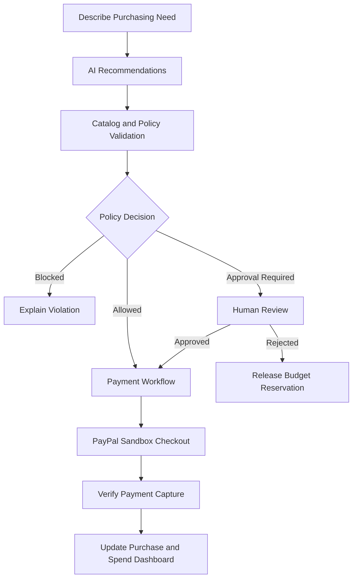

<p align="center">
  
</p>

# Procura AI
### AI-powered procurement with intelligent spending controls.

Procura AI helps small businesses make smarter purchasing decisions by combining AI-assisted product recommendations, server-enforced spending policies, human approval, and PayPal checkout in one workflow.
<br> 
**🔗 Procura Live URL:** https://procura-io.onrender.com

**Built for the PayPal AI Hackathon**

[](./LICENSE)
[](https://react.dev/)
[](https://nodejs.org/)
[](https://developer.paypal.com/)
[](https://www.postman.com/)
[](https://render.com/)
[](https://zapier.com/)

> **Demo notice:** Supplier catalogs and purchasing records are simulated. Payments use the PayPal Sandbox and do not represent real financial transactions.

---

## The Problem

Small businesses often manage purchasing across spreadsheets, supplier catalogs, approval messages, and disconnected payment workflows. This makes it difficult to control spending, enforce purchasing policies, and understand how much budget remains available.

## The Solution

Procura AI connects purchasing decisions to financial controls.

- **AI-powered recommendations:** Translate natural-language purchasing needs into catalog-grounded recommendations using Google Gemini.
- **SpendGuard AI:** Enforce order limits, approved-supplier rules, cumulative budgets, and approval thresholds on the backend.
- **Human-in-the-loop approvals:** Flag purchases that require review before payment.
- **PayPal checkout:** Create and capture PayPal Sandbox orders through a server-validated payment workflow.
- **Spending visibility:** Track paid spending, reserved budgets, available headroom, policy violations, and purchase history.

### What makes it different?

Procura AI doesn't rely on AI alone to authorize spending. AI assists with purchasing decisions, while a deterministic backend policy engine enforces financial limits. Approved purchases then follow a controlled payment workflow.

## How It Works



## Key Feature: SpendGuard AI

SpendGuard is a backend-enforced spending control system, not just a dashboard.

| Control | Default policy |
|---|---:|
| Maximum single order | $10,000 |
| Maximum order quantity | 250 units |
| Monthly cumulative budget | $20,000 |
| Auto-approval threshold | Up to $500 |
| Higher-value purchases | Manual approval required |
| Supplier restrictions | Configurable allowlist |

These are configurable demo defaults, not universal financial recommendations.

**Budget accounting includes:**
- Paid spend from completed purchases.
- Reserved spend for approved purchases awaiting payment.
- Available budget after accounting for paid and reserved amounts.
- Reservation release when an approved purchase is cancelled or rejected.
- Concurrency controls to prevent simultaneous requests from bypassing budget checks within a single server process.

## Technology Stack

| Layer | Technologies |
|---|---|
| Frontend | React, TypeScript, Vite, Tailwind CSS |
| Backend | Node.js, Express, TypeScript |
| AI | Google Gemini API, deterministic rules-engine fallback |
| Payments | PayPal JavaScript SDK, PayPal REST API v2 |
| Validation | Zod |
| Testing | Automated server tests |
| Data persistence | File-backed JSON storage |
| Deployment | Render |
| Version Control | Git & GitHub |

## Architecture

```text
React + TypeScript Client
          |
          v
    Express REST API
          |
    +-----+----------+
    |        |       |
    v        v       v
   Gemini  SpendGuard PayPal REST API
    AI     + Policies      |
    |        |             v
    +--------+        Order Capture
             |
             v
      Purchase Store
```

The backend validates purchase policies and authoritative payment amounts. The PayPal client secret remains server-side and must never be exposed to the browser.

## Getting Started

### Prerequisites

- Node.js 18 or later
- npm
- Google Gemini API key
- PayPal Developer account with Sandbox credentials

### 1. Clone the repository

```bash
git clone https://github.com/dineshit27/procura-ai.git
cd procura-ai
```

### 2. Install dependencies

```bash
npm run install:all
```

Alternatively, install dependencies in the root, `server`, and `client` directories separately.

### 3. Configure environment variables

Copy the server environment template:

```bash
cp server/.env.example server/.env
```

Configure the variables supported by the server template. The primary settings include:

```env
PORT=5000
NODE_ENV=development
CLIENT_URL=http://localhost:5173

GEMINI_API_KEY=your_gemini_api_key
GEMINI_MODEL=gemini-2.0-flash

PAYPAL_CLIENT_ID=your_sandbox_client_id
PAYPAL_CLIENT_SECRET=your_sandbox_client_secret
PAYPAL_BASE_URL=https://api-m.sandbox.paypal.com
```

Configure `PAYPAL_PAYEE_EMAIL` if required by your Sandbox setup. Use the exact variable names and defaults documented in `server/.env.example`.

Optionally, configure `client/.env`:

```env
VITE_API_URL=http://localhost:5000
```

**Never commit real API keys, PayPal secrets, or populated environment files.**

### 4. Run the application

```bash
npm run dev
```

Default local URLs:

| Service | URL |
|---|---|
| Frontend | http://localhost:5173 |
| Backend | http://localhost:5000 |
| Health check | http://localhost:5000/api/health |

## Testing and Build

Run the available validation commands from the repository root:

```bash
npm test
npm run typecheck
npm run build
```

The test suite covers policy evaluation, environment validation, PayPal checkout, AI fallback behavior, persistence, spending controls, and security-related scenarios.

The latest reported validation completed with **95 tests passing and zero failures**. Re-run the tests after changes to verify the current result.

## Security and Limitations

- **Authentication:** The demo does not implement verified user authentication. The `x-user-role` header is a development/test convention, not proof of identity. Policy mutations fail closed in production until verified authentication is integrated.
- **Simulated data:** Suppliers, catalog entries, and preloaded purchase history are demo data, not live supplier integrations.
- **AI reliability:** Gemini output assists purchasing decisions; deterministic backend rules enforce spending policies. AI recommendations are not guaranteed to be correct.
- **Payment environment:** Checkout uses PayPal Sandbox. Live payments require appropriate production credentials, configuration, security controls, and testing.
- **Persistence and scaling:** JSON storage and in-process concurrency controls are intended for the prototype. Production deployment should use a suitable database and distributed concurrency controls for multiple server instances.
- **Payment reconciliation:** Capture confirmation is handled synchronously; a PayPal webhook integration is not currently implemented.

## Future Scope

- Verified Google and email/password authentication with role-based access control.
- Live supplier and inventory integrations.
- Database-backed multi-business workspaces.
- PayPal webhook-based payment reconciliation.
- Advanced procurement analytics and configurable approval workflows.

## License

Released under the [MIT License](./LICENSE).

---

**Procura AI | Smarter purchasing. Controlled spending. Secure payment workflows.**
# Authentication setup

The dashboard requires Supabase Auth. The marketing site remains public.

1. Create a Supabase project and run `supabase/migrations/20261020_auth_rbac.sql` in its SQL editor.
2. In Supabase Auth, configure Site URL and redirect URLs for `http://localhost:5173/setup-password` and your Render URL with `/setup-password`.
3. Copy the Supabase URL and publishable/anon key to both client and server environment files. Set `SUPABASE_SERVICE_ROLE_KEY` only in `server/.env` and Render's server environment.
4. Create the first administrator in Supabase Auth, then insert that user's UUID and email in `profiles` with role `admin` using the SQL editor. There is intentionally no bootstrap-admin endpoint.
5. Sign in at `/login`; admins can call the protected invitation API to invite users. The JSON request store remains single-instance and is not appropriate for multi-instance production; migrate purchase data to a database before scaling.
