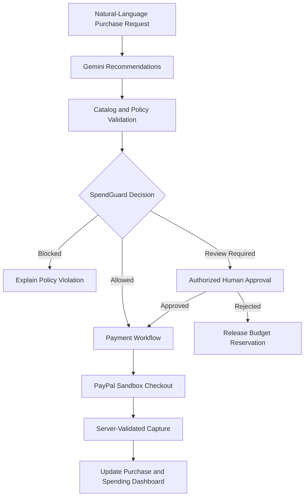

# Procura AI

### Smarter purchasing. Controlled spending. Secure payment workflows.

Procura AI is an AI-powered procurement platform that helps small businesses make smarter purchasing decisions without losing control of their budgets. It combines natural-language product recommendations, backend-enforced spending policies, human approvals, and PayPal Sandbox checkout in one workflow.

<p align="center">
  
</p>

<p align="center">
  <a href="https://procura-io.onrender.com">Live Demo</a> ·
  <a href="https://github.com/dineshit27/procura-ai">Source Code</a> ·
  <a href="https://procura-ai-f4eo.onrender.com/api/health">API Health</a>
</p>

<p align="center">
  
  [](./LICENSE)
  [](https://react.dev/)
  [](https://nodejs.org/)
  [](https://developer.paypal.com/)
  [](https://www.postman.com/)
  [](https://render.com/)
  [](https://zapier.com/)
  
</p>

**Built for the PayPal AI Hackathon.**

> **Demo notice:** Supplier catalogs and purchasing records are simulated demonstration data. Payments use PayPal Sandbox and do not move real money.

---

## The Problem

Small businesses often manage procurement through spreadsheets, disconnected supplier catalogs, manual approvals, and separate payment workflows.

This makes it difficult to enforce purchasing policies, monitor cumulative spending, prevent overspending, and maintain visibility into purchase decisions.

## The Solution

Procura AI connects purchasing intelligence with deterministic financial controls.

- **AI procurement recommendations:** Convert natural-language purchasing needs into catalog-grounded recommendations using Google Gemini.
- **SpendGuard AI:** Enforce order limits, quantity restrictions, approved-supplier rules, cumulative budgets, and approval requirements on the backend.
- **Human-in-the-loop approvals:** Route purchases requiring review through authorized approval workflows.
- **PayPal Sandbox checkout:** Create and capture payment orders through a server-validated payment flow.
- **Budget visibility:** Track completed spending, reserved amounts, available budget, and purchase history.
- **Role-based access control:** Use Supabase authentication and server-verified roles for administrative, procurement, finance, and requester permissions.

### What makes Procura AI different?

**AI recommends; deterministic policy enforcement controls spending.**

An AI-generated recommendation is not authorization to spend money. Procura AI evaluates purchasing requests against backend-enforced policies, preserves required human approval, and validates payment details before a purchase is completed.

This separation between AI assistance and financial authorization is central to the product.

---

## How It Works



1. A user describes a purchasing requirement.
2. Procura AI generates recommendations grounded in the available demonstration catalog.
3. SpendGuard validates the request against configured policies.
4. Requests requiring approval are routed to an authorized reviewer.
5. Eligible purchases proceed through PayPal Sandbox checkout.
6. The backend validates payment capture before updating purchase status and spending records.

---

## SpendGuard AI

SpendGuard is a backend-enforced purchasing policy engine, not merely a dashboard or AI-generated warning.

| Control | Demonstration default |
|---|---:|
| Maximum single order | $10,000 |
| Maximum order quantity | 250 units |
| Monthly cumulative budget | $20,000 |
| Auto-approval threshold | Up to $500 |
| Higher-value purchases | Manual approval required |
| Supplier restrictions | Configurable allowlist |

These values are configurable demonstration defaults, not universal financial recommendations. Actual approval behavior depends on the configured policies and applicable workflow rules.

### Budget accounting

SpendGuard tracks:

- Completed purchases and paid spending.
- Reserved budget for approved purchases awaiting payment.
- Available budget after paid and reserved amounts.
- Budget reservation release when applicable purchases are cancelled or rejected.
- Concurrent requests within the limits of the current single-server implementation.

Policy decisions are enforced by the backend. Client-side controls alone cannot authorize a purchase or override server-side spending limits.

---

## Authentication and Permissions

Procura AI uses Supabase Auth for identity verification and resolves application roles from trusted server-side `public.profiles` records.

| Role | Intended permissions |
|---|---|
| `admin` | Manage authorized users, roles, and permitted system settings |
| `procurement_manager` | Review and perform authorized procurement approvals |
| `finance_manager` | Access permitted finance and budget information |
| `requester` | Create purchase requests and view permitted records |

The backend verifies the authenticated user's access token and resolves the user's role independently. Client-supplied role values and forged role headers are not trusted.

A successfully authenticated Supabase user must also have a valid application role assignment before accessing protected resources.

### Judge demo access

The Quick Demo Access cards select the configured demo account email. Judges must enter the corresponding temporary password to sign in.

For a safe demonstration:

- Use disposable demo accounts and temporary passwords.
- Assign each account its intended role on the server.
- Keep passwords and service-role keys out of frontend code and GitHub.
- Provide judge credentials through the event's designated private instructions.
- Use simulated procurement records and PayPal Sandbox.
- Verify role permissions before sharing access.

**Environment note:** A separate Supabase project and backend deployment containing only demonstration data is recommended for public judging. If the current deployment uses the same Supabase project as development, do not describe it as an isolated demo environment until the separation is completed and verified.

---

## Technology Stack

| Layer | Technologies |
|---|---|
| Frontend | React, TypeScript, Vite, Tailwind CSS |
| Backend | Node.js, Express, TypeScript |
| AI | Google Gemini API with deterministic fallback |
| Authentication | Supabase Auth and server-side role checks |
| Payments | PayPal JavaScript SDK and REST Orders API |
| Validation | Zod |
| Persistence | File-backed JSON storage |
| Testing | Automated server tests |
| Deployment | Render |
| Version control | Git and GitHub |

## Architecture

```text
React + TypeScript Frontend
            |
            v
      Express REST API
            |
     +------+-------+----------------+
     |              |                |
     v              v                v
 Supabase Auth   SpendGuard       Gemini API
 Role Lookup     Policy Engine    Recommendations
     |              |
     +------+-------+
            |
            v
   Purchase Data Store
            |
            v
     PayPal REST API
            |
            v
   Order Capture and Validation
```

The frontend handles user interaction and presentation. The backend remains responsible for authentication checks, role authorization, spending policies, authoritative order amounts, and payment validation.

PayPal client secrets and Supabase service-role keys must remain exclusively on the server.

---

## Getting Started

### Prerequisites

- Node.js 18 or later, compatible with the dependencies in this repository.
- npm.
- A Google Gemini API key.
- A Supabase project with the required authentication configuration.
- A PayPal Developer account with Sandbox credentials.

### 1. Clone the repository

```bash
git clone https://github.com/dineshit27/procura-ai.git
cd procura-ai
```

### 2. Install dependencies

```bash
npm run install:all
```

If the root installation script is unavailable in your checkout, install dependencies separately in the root, `server`, and `client` directories.

### 3. Configure the backend

Copy the server environment template:

```bash
cp server/.env.example server/.env
```

Configure the variables supported by `server/.env.example`. The primary settings include:

```env
PORT=5000
NODE_ENV=development
CLIENT_URL=http://localhost:5173

GEMINI_API_KEY=your_gemini_api_key
GEMINI_MODEL=your_supported_gemini_model

SUPABASE_URL=https://your-project.supabase.co
SUPABASE_ANON_KEY=your_supabase_anon_key
SUPABASE_SERVICE_ROLE_KEY=your_server_only_service_role_key

PAYPAL_CLIENT_ID=your_sandbox_client_id
PAYPAL_CLIENT_SECRET=your_sandbox_client_secret
PAYPAL_BASE_URL=https://api-m.sandbox.paypal.com
```

Use the exact environment-variable names and supported defaults in the checked-in template. Configure `PAYPAL_PAYEE_EMAIL` only if required by your Sandbox setup.

Never commit populated `.env` files, API keys, service-role keys, or payment secrets.

### 4. Configure the frontend

Create `client/.env.local`:

```env
VITE_API_URL=http://localhost:5000
VITE_SUPABASE_URL=https://your-project.supabase.co
VITE_SUPABASE_ANON_KEY=your_supabase_anon_key

VITE_DEMO_ADMIN_EMAIL=demo-admin@example.com
VITE_DEMO_PROCUREMENT_EMAIL=demo-procurement@example.com
VITE_DEMO_FINANCE_EMAIL=demo-finance@example.com
VITE_DEMO_REQUESTER_EMAIL=demo-requester@example.com
```

Replace the example email addresses with the actual disposable Supabase Auth users configured for your environment.

The `VITE_*` values are embedded in the frontend build and are not secret storage. Never put passwords or `SUPABASE_SERVICE_ROLE_KEY` in frontend variables.

### 5. Configure Supabase

Review the existing migrations before applying them:

- `supabase/migrations/20261020_auth_rbac.sql`
- `supabase/migrations/20261020_initial_admin_setup.sql`

Apply each migration in the intended Supabase project, following the repository's setup instructions. Do not rerun setup commands blindly against a populated database.

Create or confirm the required Auth users and ensure their UUIDs match their trusted `public.profiles` role assignments.

For initial administrator setup, use the documented server-only setup command and its required confirmation variables:

```bash
npm --prefix server run setup:initial-admin
```

For the four demo-role assignments, use the repository's documented `setup:demo-roles` procedure if it is present in your current checkout. Verify the command's preconditions and the existing role mappings before execution.

Remove temporary setup confirmation variables immediately after successful setup. Never expose the service-role key or role-assignment operations through the browser.

### 6. Run the application

Use the development scripts supported by your checkout:

```bash
npm run dev
```

The default local addresses are:

| Service | URL |
|---|---|
| Frontend | `http://localhost:5173` |
| Backend | `http://localhost:5000` |
| API health | `http://localhost:5000/api/health` |

If the root development script does not start both services, use the separate client and server scripts documented in the package files.

---

## Testing and Build

The repository includes automated tests covering areas such as policy evaluation, authentication and authorization, PayPal checkout, AI fallback behavior, persistence, and spending controls.

Run the available checks from the repository root:

```bash
npm test
npm run typecheck
npm run build
```

Run the current suite after changes and report the actual result. Do not rely on historical test counts as proof that the latest code passes.

### Manual verification checklist

- Sign in with each of the four demo roles.
- Verify that each role receives only its permitted data and actions.
- Confirm that missing or invalid tokens cannot access protected endpoints.
- Confirm that forged role headers cannot grant privileges.
- Test policy blocks, approval requirements, and budget reservation behavior.
- Complete a PayPal Sandbox checkout.
- Confirm that payment failures do not incorrectly mark purchases as paid.
- Test the deployed frontend and backend, not just the local development environment.

---

## Security and Limitations

- **Role enforcement:** The backend verifies Supabase access tokens and resolves application roles from trusted server-side records.
- **Simulated suppliers:** Supplier catalogs, company departments, and preloaded purchase records are demonstration entities, not live supplier integrations.
- **AI reliability:** Gemini assists with recommendations. Its output is not guaranteed to be correct and does not independently authorize spending.
- **Payment environment:** PayPal Sandbox is used for demonstration transactions. Production payments would require separate configuration, security review, and testing.
- **Persistence:** JSON-based storage and in-process concurrency controls are suitable for a prototype but are not a substitute for a production database and distributed coordination.
- **Payment reconciliation:** The current implementation does not include a complete PayPal webhook-based reconciliation workflow.
- **Demo credentials:** Shared temporary passwords are for controlled judging only, not a production authentication model.

## Future Scope

- Live supplier catalog and inventory integrations.
- Database-backed multi-business workspaces.
- PayPal webhook-based payment reconciliation.
- More configurable approval workflows and procurement analytics.
- Production-grade persistence, monitoring, and distributed concurrency controls.
- Additional authentication options where appropriate for the deployment.

## License

This project is released under the [MIT License](./LICENSE).

---

<p align="center">
  <strong>Procura AI</strong><br />
  Smarter purchasing. Controlled spending. Secure payment workflows.
</p>
